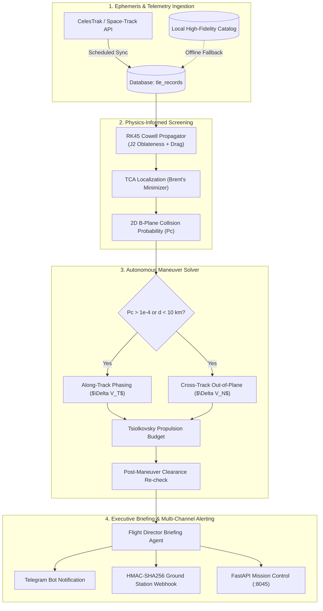

# 🛰️ OrbitGuard AI
### Autonomous Conjunction Screening & Maneuver Recommendation Copilot

**OrbitGuard AI** is a micro-SaaS vertical designed for university CubeSat teams, small satellite constellations, and orbital dynamics researchers. It acts as an autonomous 24/7 "Mission Control Copilot", continuously screening Low-Earth Orbit (LEO) satellites against space debris catalogs, calculating collision risks, synthesizing optimal collision avoidance maneuvers (CAM), generating flight director executive briefings, and dispatching multi-channel alerts.

---

## ⚡ Key Highlights & Capabilities

1. **Automated Ephemeris & TLE Ingestion**: Pulls fresh orbital data from CelesTrak and Space-Track, solves Kepler's equation via Newton-Raphson iteration, and tracks epoch updates.
2. **NanoDynamics Physics Engine Core**: Leverages high-precision numerical orbit propagation with Runge-Kutta 4(5) Cowell formulation integrating:
   - Central Earth two-body gravity ($\mu = 3.986 \times 10^{14}\text{ m}^3/\text{s}^2$)
   - Earth oblateness $J_2$ perturbation ($\dot{\Omega}$ regression of nodes and apsidal drift)
   - Atmospheric drag with exponential thermospheric model and Earth co-rotation velocity.
3. **72-Hour Conjunction Screening Window**:
   - Detects close approaches within user-configurable distance thresholds ($d \le 10\text{ km}$).
   - Employs Brent's scalar minimization algorithm to locate the exact sub-second Time of Closest Approach (TCA).
   - Resolves encounter frame in RTN (Radial, In-track, Cross-track) and VNC (Velocity, Normal, Co-Normal) coordinate frames.
   - Computes 2D B-plane collision probability ($P_c$) using the Akella-Alfriend / Foster formulation.
4. **Autonomous Maneuver Recommendation Engine**:
   - Solves for along-track phasing burns ($\Delta V_T$ prograde/retrograde) and cross-track out-of-plane burns ($\Delta V_N$ normal/antinormal).
   - Computes propellant mass depletion and continuous thrust duration using the Tsiolkovsky rocket equation.
   - Re-propagates the post-burn state to confirm safety margin expansion ($> 25\text{ km}$ clearance) and verify perigee safety ($> 200\text{ km}$).
5. **LLM Flight Director Briefings**:
   - Automatically formats NASA CARA / AIAA compliant executive mission briefings with full telemetry, burn vectors, and operator action items.
6. **Multi-Channel Alert Dispatcher**:
   - Real-time Telegram alerts with 1-click CAM authorization.
   - HMAC-SHA256 signed JSON webhooks for university ground stations.

---

## 🏛️ System Architecture



---

## 💾 Database Schema (PostgreSQL / Supabase + RLS)

The full DDL is provided in [`sql/001_initial_schema.sql`](sql/001_initial_schema.sql):

- `tenants`: University labs, CubeSat teams, NewSpace operators.
- `satellites`: Monitored assets with dry mass, propellant capacity, drag area, $C_D$, thruster type, $I_{\text{sp}}$, and thrust.
- `tle_records`: Time-series NORAD element sets.
- `debris_catalog`: Tracked resident space objects and fragmentation debris.
- `conjunction_screenings`: Close approaches, TCA timestamps, miss distances, relative velocities, and $P_c$.
- `maneuver_recommendations`: Optimal burn parameters ($\Delta \mathbf{V}_{\text{VNC}}$, duration, fuel used, post-burn miss distance).
- `alert_dispatches`: Multi-channel notification delivery logs.
- `audit_logs`: Immutable security and operation audit trail.

---

## 🚀 Quick Start & CLI Usage

### 1. Environment Setup
```bash
# Enter project directory
cd /home/m/Projects/orbitguard-ai

# Activate virtual environment
source .venv/bin/activate
```

### 2. Run Test Suite
```bash
PYTHONPATH=src pytest -v
```

### 3. Run Mission Control Simulation (Threat Conjunction & Autonomous CAM)
```bash
PYTHONPATH=src python -m orbitguard.cli simulate
```

### 4. Run 72-Hour Conjunction Screening Sweep
```bash
PYTHONPATH=src python -m orbitguard.cli screen --hours 72
```

### 5. Launch FastAPI Service
```bash
PYTHONPATH=src uvicorn orbitguard.main:app --host 0.0.0.0 --port 8045 --reload
```
Interactive API documentation will be available at `http://localhost:8045/docs`.
